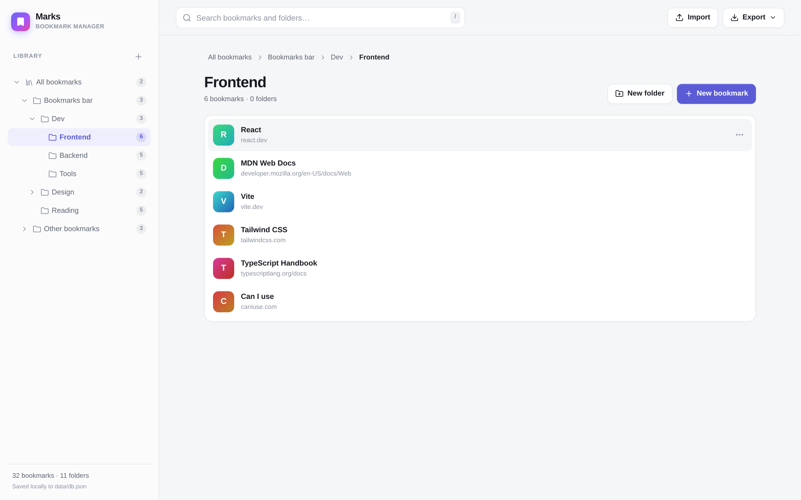
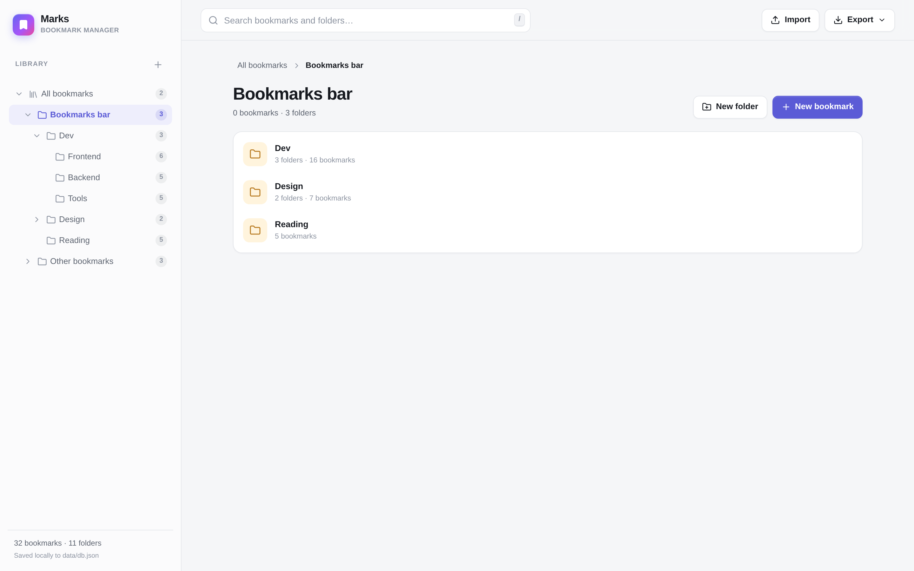
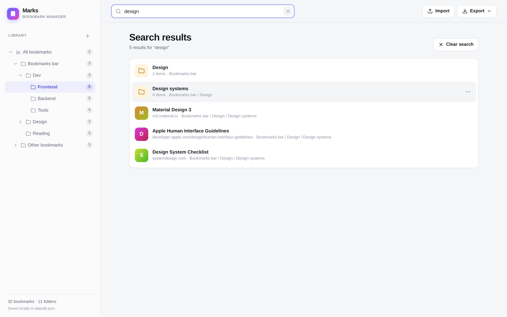
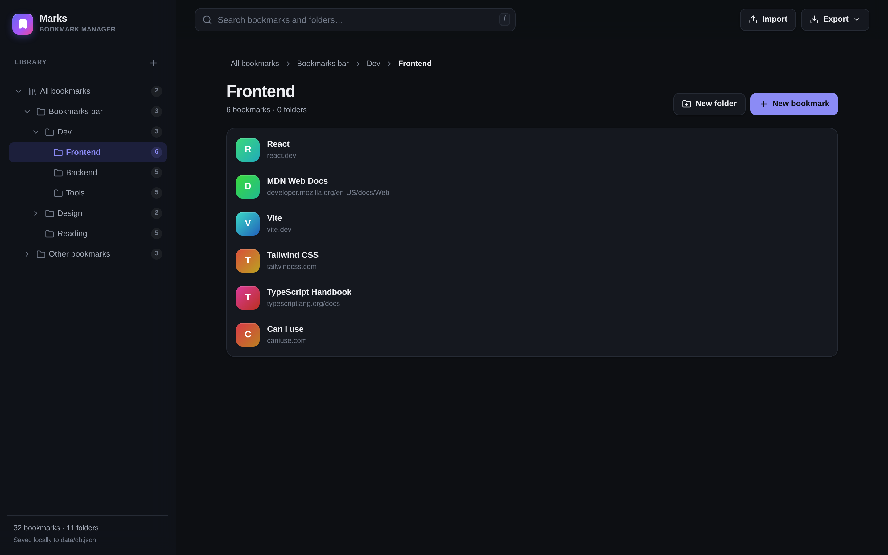

# Marks — Bookmark manager

[](https://github.com/philiplus/marks-bookmark-manager/actions/workflows/ci.yml)
[](https://github.com/philiplus/marks-bookmark-manager/actions/workflows/codeql.yml)
[](LICENSE)
[](package.json)
[](tsconfig.json)

A local-first bookmark manager built with TypeScript. Import a Google Chrome bookmarks
export (`.html`), keep the original folder hierarchy, and manage everything from a clean
web UI. All data lives in a single JSON file on the server, exposed through a small CRUD API.



## Features

- **Chrome bookmark import** — parses the Netscape/Chrome export format, including nested
  folders, entity-encoded titles and URLs, `ADD_DATE` timestamps, descriptions (`<DD>`), and
  empty folders.
- **Folder hierarchy preserved** — the import tree is recreated exactly, then stored and
  rendered as a nested folder tree.
- **Full CRUD** — create, rename, edit, move, and delete bookmarks and folders.
- **Drag and drop** — drag bookmarks or folders onto folders in the sidebar, on folder rows,
  or on breadcrumbs to move them. Moving a folder into one of its own descendants is rejected.
- **Search** — instant search across bookmark titles, folder names, and URLs, with the full
  folder path shown for each result.
- **JSON file database** — `data/db.json` is created automatically, written atomically, and
  guarded by a serialized mutation queue.
- **Backups and round-tripping** — export the library as a JSON backup or as a Chrome-compatible
  bookmarks HTML file.
- **Light/dark UI** — follows the operating system theme, with a responsive layout for mobile.
- **Keyboard shortcuts** — `/` focuses search, `Esc` closes dialogs.

## Screenshots

| Browse folders | Search everything |
| --- | --- |
|  |  |

Dark mode follows the operating system theme:



## Documentation

- [REST API reference](docs/API.md) — endpoints, payloads, validation, and error codes
- [Contributing guide](CONTRIBUTING.md) — local setup, tests, and pull request process
- [Security policy](SECURITY.md) — private vulnerability reporting and threat model
- [Code of conduct](CODE_OF_CONDUCT.md)

## Quick start

Requires Node.js 22.12 or newer.

```bash
npm install
npm run dev
```

Open <http://localhost:5173>. The API runs on port `3001` and Vite proxies `/api` requests to it.

To try the importer immediately, use the included sample:
[`samples/chrome-bookmarks.html`](samples/chrome-bookmarks.html).

### Production build

```bash
npm run build
npm start
```

Open <http://localhost:3001>. The Express server serves the built frontend from `dist/client`
and falls back to `index.html` for client-side routes.

## Importing from Chrome

1. In Chrome, open **Bookmarks → Bookmark manager**.
2. Use the three-dot menu → **Export bookmarks**.
3. In Marks, click **Import** and choose the exported HTML file.
4. Pick an import mode:
   - **Add as a new folder** (default when the library is not empty) keeps your existing
     bookmarks and places the import in its own folder.
   - **Replace everything** clears the current library and uses the file as the new one.

The importer recreates Chrome's top-level folders (`Bookmarks bar`, `Other bookmarks`, and so
on) inside the library root.

## Data storage

By default the database is `data/db.json` relative to the working directory:

```json
{
  "version": 1,
  "updatedAt": "2026-11-02T00:00:00.000Z",
  "root": {
    "id": "…",
    "type": "folder",
    "title": "Bookmarks",
    "createdAt": "…",
    "updatedAt": "…",
    "children": [
      {
        "id": "…",
        "type": "bookmark",
        "title": "React",
        "url": "https://react.dev/",
        "createdAt": "…",
        "updatedAt": "…"
      }
    ]
  }
}
```

Configuration:

| Variable  | Default              | Description                          |
| --------- | -------------------- | ------------------------------------ |
| `PORT`    | `3001`               | API / production server port         |
| `DB_PATH` | `./data/db.json`     | Path to the JSON database file       |

Writes use a temp file plus rename, and all mutations are serialized in-process. The JSON store
is intended for a single server process; do not point multiple instances at the same file.

## REST API

All endpoints are JSON except the exports. The table below is a quick reference; see
**[docs/API.md](docs/API.md)** for the complete reference with payload schemas, validation
rules, error codes, and client examples.

| Method   | Endpoint                | Body / query                                      | Description |
| -------- | ----------------------- | ------------------------------------------------- | ----------- |
| `GET`    | `/api/health`           | —                                                 | Health check |
| `GET`    | `/api/tree`             | —                                                 | Full database tree |
| `POST`   | `/api/nodes`            | `{ type, parentId, title, url? }`                 | Create a folder or bookmark |
| `PATCH`  | `/api/nodes/:id`        | `{ title?, url? }`                                | Rename/edit a node |
| `DELETE` | `/api/nodes/:id`        | —                                                 | Delete a node (folders recursively) |
| `POST`   | `/api/nodes/:id/move`   | `{ parentId, index? }`                            | Move a node into a folder |
| `POST`   | `/api/import`           | `{ html, mode: "replace" \| "merge", name? }`     | Import a Chrome export |
| `GET`    | `/api/export/json`      | —                                                 | Download a JSON backup |
| `GET`    | `/api/export/html`      | —                                                 | Download a Chrome-compatible HTML export |

Examples:

```bash
# Create a folder at the root (get the root id from /api/tree)
curl -X POST http://localhost:3001/api/nodes \
  -H 'content-type: application/json' \
  -d '{"type":"folder","parentId":"ROOT_ID","title":"Design"}'

# Add a bookmark
curl -X POST http://localhost:3001/api/nodes \
  -H 'content-type: application/json' \
  -d '{"type":"bookmark","parentId":"FOLDER_ID","title":"Dribbble","url":"https://dribbble.com"}'

# Import a Chrome export (merge into a new folder)
node --input-type=module -e '
  import fs from "node:fs";
  const response = await fetch("http://localhost:3001/api/import", {
    method: "POST",
    headers: { "content-type": "application/json" },
    body: JSON.stringify({
      html: fs.readFileSync("samples/chrome-bookmarks.html", "utf8"),
      mode: "merge",
      name: "Chrome import"
    })
  });
  console.log(await response.json());
'
```

Errors are returned as `{ "error": "message" }` with an appropriate HTTP status.

## Project layout

```
server/
  index.ts        Express app, routes, static serving
  store.ts        JSON database, atomic persistence, CRUD + move rules
  parser.ts       Chrome/Netscape bookmark HTML parser
  parser.test.ts  Parser unit tests (node:test)
  html.ts         Chrome-compatible HTML exporter
  errors.ts       HttpError
shared/
  types.ts        Shared API/data types
src/
  App.tsx         App state, drag and drop, modals, search
  api.ts          Typed fetch client
  utils.ts        Tree traversal, search, URL helpers
  dnd.ts          Drag-and-drop interface
  components/     Sidebar, topbar, list rows, modals, toasts
  styles.css      Theme, layout, responsive styles
samples/
  chrome-bookmarks.html
docs/
  API.md          REST API reference
  screenshots/    README screenshots
.github/
  workflows/      CI, CodeQL, and release automation
  ISSUE_TEMPLATE/ Bug and feature request forms
```

## Development

```bash
npm run dev        # API (watch) + Vite dev server
npm test           # parser and store tests
npm run typecheck  # client + server TypeScript checks
npm run build      # production frontend build
npm start          # production server
```

See [CONTRIBUTING.md](CONTRIBUTING.md) before opening a pull request. CI runs the
typecheck, tests, and build on Node.js 22 and 24; CodeQL and Dependabot keep dependencies
and code scanning up to date.

## Contributing

Contributions are welcome. Please read [CONTRIBUTING.md](CONTRIBUTING.md) and the
[Code of Conduct](CODE_OF_CONDUCT.md), then open an issue or pull request. For security
issues, follow [SECURITY.md](SECURITY.md) instead of opening a public issue.

## Notes and limits

- This is a single-user, local-first app. There is no authentication; do not expose the server
  to the public internet without putting an auth layer in front of it.
- Import size is limited to 30 MB.
- User-created bookmark URLs are restricted to `http` and `https`. Imported URLs are stored
  as-is for fidelity but only safe schemes (`http`, `https`, `mailto`, `ftp`, `file`) are
  rendered as clickable links.
- Titles are always rendered as text. The HTML exporter escapes titles, URLs, and descriptions.

## License

Released under the [MIT License](LICENSE). © 2026 Filipe M Costa.
